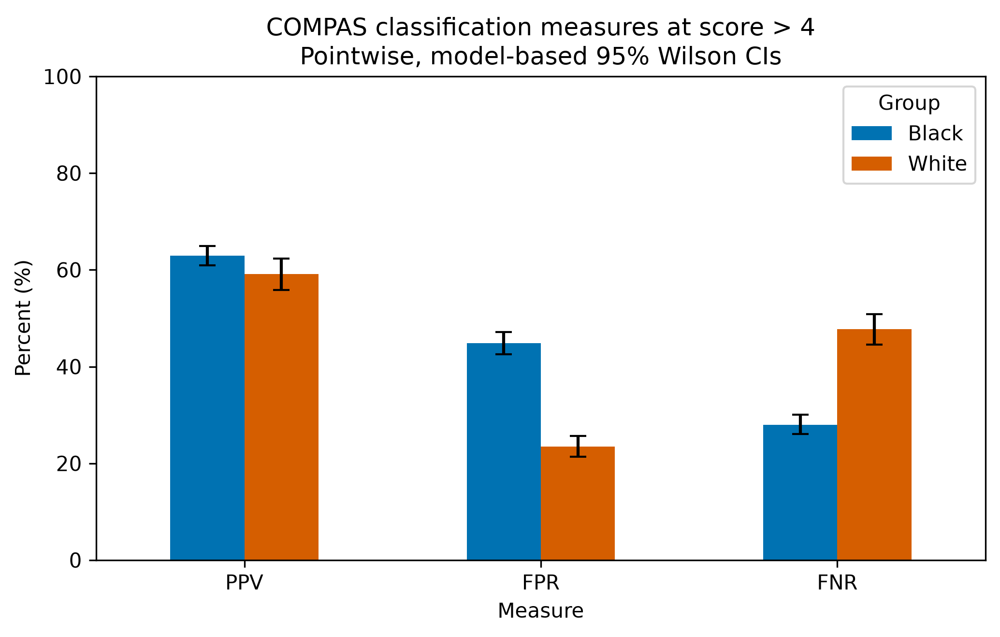
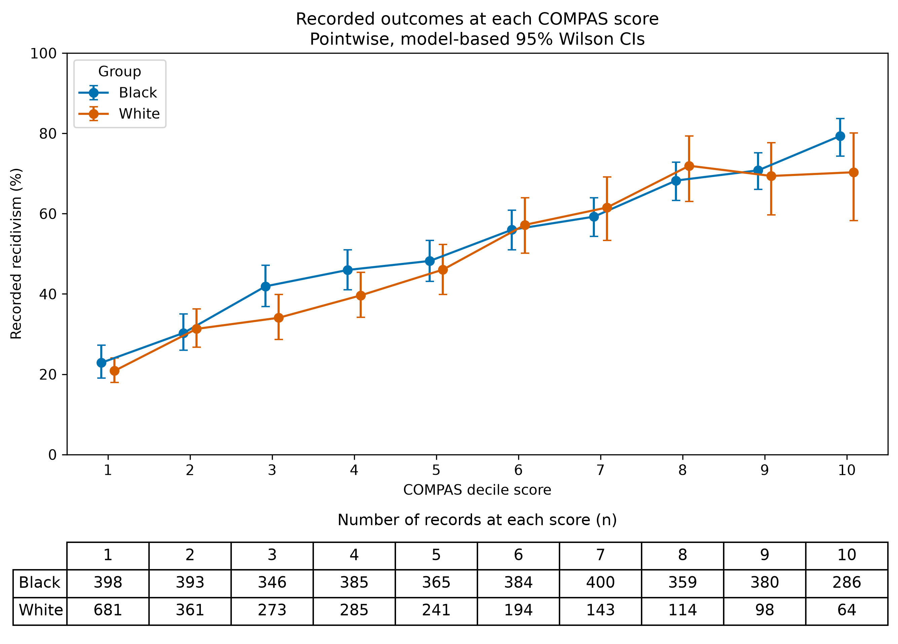

I teach introductory R at Boise State. When I started looking at historical records for DATA-R155, I had two questions: Who takes the course? And how do students do once they enroll? I made a graph for each question.

In the first graph, I compare the bars on each row. First-generation students made up a smaller share of enrollments in my course than in the university comparison.

{#fig-r155-enrollment fig-alt="Horizontal bar chart comparing the makeup of DATA-R155 enrollments with Boise State overall. The course bar for first-generation students is shorter than the university bar." style="background-color: white;"}

Then I looked at grades. The largest difference between the plotted averages was on the first-generation row, where first-generation students had a lower mean grade than continuing-generation students. Average grades were also lower for students from rural Idaho and for students from underrepresented racial and ethnic groups, each compared with students outside that group. These patterns are worth looking at more closely.

{#fig-r155-grades fig-alt="Paired points with intervals show mean grade points by academic and demographic characteristics. The first-generation marker lies to the left of the continuing-generation marker." style="background-color: white;"}

With more course data now available, I’m looking more closely at course outcomes as part of my [scholarship of teaching and learning](https://lorrainegaudio.github.io/teaching.html#sotl). I want to know how often students complete the course and whether that pattern looks similar across groups.

I want students from every background to build data literacy. These students may or may not enter the research field, but all of them are members of our community. Research benefits when people with different life experiences participate and bring new questions and insights. Communities make better decisions when everyone can weigh evidence for themselves.

I want to improve outcomes for all my students. What would make a comparison across groups fair?

I found a related question in Brian Christian’s *The Alignment Problem*. My teaching study looks at outcomes that have already happened. Christian describes a case where people made predictions first and then looked at what happened afterward. The case involved COMPAS, a tool used to assess the risk of reoffending. What caught my attention was that people examining the same risk scores reached different conclusions about fairness. I wanted to work through the math and see what each side was counting.

In Broward County, Florida, judges received COMPAS scores to help them decide whether to release someone before trial. The score was one piece of information they could consider. In 2016, [ProPublica investigated](https://www.propublica.org/article/how-we-analyzed-the-compas-recidivism-algorithm) how well those scores predicted later outcomes. To check the predictions, the reporters looked for qualifying new arrests under a two-year follow-up rule.

ProPublica drew attention to who was misclassified. Among defendants with no qualifying rearrest, Black defendants were more often labeled higher risk than White defendants. Among those who did have a qualifying rearrest, White defendants were more often labeled lower risk than Black defendants. ProPublica saw those differences as evidence of racial bias.

[Northpointe, the company that developed COMPAS](https://njoselson.github.io/pdfs/ProPublica_Commentary_Final_070616.pdf#page=4), disputed that conclusion. One comparison it emphasized started with everyone who received a higher-risk label. Within that group, the share who later had a qualifying rearrest was fairly close for Black and White defendants. The questions sound alike until you look at who goes into each calculation. ProPublica started with what happened afterward and asked how often the label was wrong. Northpointe started with the label and asked how often it matched the outcome.

To see how both results could be true, I went back to the counts. Using ProPublica’s published data, I grouped scores of 1 through 4 as lower risk and scores of 5 through 10 as higher risk, following the published analysis. I counted the results separately for Black and White defendants. For each person, I had two pieces of information: the risk label and whether a qualifying rearrest was recorded. Those two answers can be paired in four ways. A **confusion matrix** is a table that counts how often each pairing occurred.

### Who’s in the denominator?

I put the recorded outcomes in the rows and the risk labels in the columns. Each number counts people with that particular combination.

| Group | Recorded outcome | Lower risk (scores 1–4) | Higher risk (scores 5–10) |
|---|---|---:|---:|
| Black | No qualifying rearrest | 990 | **805** |
| Black | Qualifying rearrest | 532 | 1,369 |
| White | No qualifying rearrest | 1,139 | 349 |
| White | Qualifying rearrest | 461 | 505 |

I started with the **805**. These were Black defendants who received a higher-risk label and had no qualifying rearrest in the records. In this analysis, a higher-risk label is the positive prediction, so these cases count as *false positives*.

To ask **how often people without a recorded rearrest received a higher-risk label**, I read across the first row. There were 990 people labeled lower risk and 805 labeled higher risk. The false-positive rate was **805 ÷ (990 + 805) = 44.8%**.

Now I can start with the same 805 and ask a different question: **among people labeled higher risk, how many had no recorded rearrest?** This time I read down the higher-risk column for Black defendants. There were 805 people without a qualifying rearrest and 1,369 with one. The answer was **805 ÷ (805 + 1,369) = 37.0%**. The other 63.0% had a recorded rearrest. That share is called *precision*, or *positive predictive value*.

The 805 people stayed the same. What changed was who I counted them alongside. The first question starts with the recorded outcome. The second starts with the risk label. To get the *false-negative rate*, I start with the other recorded outcome: among people who did have a qualifying rearrest, what share had been labeled lower risk?

Once I had the three measures, I could compare them for Black and White defendants. Would the groups look as similar on the error rates as they did on precision?

### The gaps depend on what I count

I plotted the three measures side by side. To read the chart, I compare the two bars within each pair. When I move to the next pair, I’m asking about a different set of people.

{#fig-compas-classification fig-alt="Precision is relatively close for Black and White defendants. The false-positive rate is higher for Black defendants, and the false-negative rate is higher for White defendants."}

The first pair is the closest. Among defendants labeled higher risk, **63.0% of Black defendants and 59.1% of White defendants** had a qualifying rearrest. That’s the comparison Northpointe emphasized. The two percentages are close in this dataset, but overlapping confidence intervals don’t establish that precision is equal.

The next two pairs tell a different story. Among defendants **without** a qualifying rearrest, **44.8% of Black defendants and 23.5% of White defendants** had been labeled higher risk. Among defendants **with** a qualifying rearrest, the gap goes the other way: **28.0% of Black defendants and 47.7% of White defendants** had been labeled lower risk.

I can see why a judge would want to know how often a higher-risk label corresponded to a recorded rearrest. That’s the question precision answers. But if the label carries weight in a release decision, I also want to know who could bear the cost of a mistake. A false positive could contribute to stricter release conditions or detention. That could affect someone’s ability to work or care for their family.

A false negative raises a different concern. If a judge relies on a lower-risk label, a safety concern might get less attention. A family can care about safety in their community and about what happens when someone is held before trial unnecessarily. A judge can care about both, too.

The three rates make different concerns visible. Deciding which errors deserve the most attention means asking what we want the assessment to accomplish and who gets a say in weighing those consequences.

My analysis can show who received those labels and how they matched the recorded outcomes. It can’t tell me how judges acted on them.

So far, I’ve grouped scores of 5 through 10 under one label. What would I see if I compared people who received the exact same score?

### Does a 6 mean the same thing for both groups?

In @fig-compas-classification, I grouped scores of 5 through 10 under one label: higher risk. Then I went back to the individual scores. Among people who received a 6, for example, how many had a qualifying rearrest?

In the records I analyzed, **215 of 384 Black defendants** who received a 6 had a qualifying rearrest. That’s **56.0%**. So did **111 of 194 White defendants** with that score, or **57.2%**. A score of 6 doesn’t mean a 60% chance of rearrest. I got these percentages by counting what happened among people who received that score.

{#fig-compas-scorewise fig-alt="Recorded rearrest rates generally rise with COMPAS scores for both groups. The rates are often close at the same score, though some gaps are larger than others."}

In this chart, I compare the two points at each score. The rates generally rise for both groups, and the two lines broadly follow each other, though they’re farther apart at some scores than at others. The table helps explain why some estimates are less precise. At score 10, for instance, there were only 64 records for White defendants, compared with 286 for Black defendants. The estimate based on 64 records has a wider interval.

This comparison is a check for **calibration across groups**: does a given score correspond to a similar observed rearrest rate for Black and White defendants? The chart shows broadly similar rates at matching scores, but overlapping intervals don’t establish that the rates are equal.

**Precision** starts with everyone I labeled higher risk, pooling scores of 5 through 10. Calibration lets me ask about a 6 without counting the 5s, 7s, or any other scores. That matters because the groups can have different mixes of scores. Even if the rates matched at every individual score, the pooled percentages could still differ.

There’s one more denominator I haven’t used yet: everyone in each group. That tells me how common recorded rearrest was before I narrowed the comparison to any particular score or label.

### Why the starting mix matters

This time, I counted everyone in each group. In the records I analyzed, **1,901 of 3,696 Black defendants (51.4%)** and **966 of 2,454 White defendants (39.4%)** had a qualifying rearrest. Those percentages are the *base rates*. They tell me how common a recorded rearrest was in each group before I look at any score or risk label.

To see why that matters, I went back to the two rows of the confusion matrix. Matching false-positive rates would mean that the same fraction of people **without** a recorded rearrest received a higher-risk label in both groups. Matching false-negative rates would mean that the same fraction of people **with** a recorded rearrest received a lower-risk label. So the fraction of that second row labeled higher risk would match across groups, too.

Now look down the higher-risk column. Even if the fractions matched across groups in both rows, the rows would still make up different shares of each group. Where recorded rearrest was more common to begin with, a larger share of the higher-risk labels would come from the rearrest row. That share is precision. It would differ even though both error rates matched.

[Alexandra Chouldechova shows how this follows from the confusion matrix](https://arxiv.org/html/1703.00056#S2.SS3). For predictions like these, where higher-risk labels go to people both with and without a recorded rearrest, unequal base rates mean **precision and both error rates can’t all match exactly**. In my analysis, precision was relatively close and both error rates differed. The math helps explain how those findings can coexist. It leaves open why the recorded rearrest rates differed and which errors should matter most when someone acts on a score.

### Back to my R course

I recognized the same pattern in a study by [Hansol Lee and René Kizilcec](https://arxiv.org/pdf/2007.00088#page=2). They built a model to predict whether students would earn at least the median grade in a course. At the same cutoff, precision was close: **77.0%** for students the authors grouped as underrepresented racial and ethnic minorities and **78.7%** for the comparison group.

Then I looked at who was in the denominator. Those percentages count only students the model predicted would meet the grade benchmark. Start instead with the students who **actually met it**, and the comparison changes. The model missed **35.1%** of those students in the first group and **14.9%** in the comparison group. The study measured how the predictions performed. It didn’t measure who received help as a result.

That brings me back to the two graphs I made from the historical DATA-R155 records. One asks who enrolled. The other asks how average grades varied. As I look more closely at course completion, I want to keep those questions separate. Who is represented in the records? What can the outcomes tell me about their experience in the course?

I want students with different life histories to have a chance to learn these skills and put them to use. That includes students from rural Idaho, first-generation students, and students from underrepresented racial and ethnic groups. Those who go on to do research may ask questions or notice gaps in the evidence that others might miss. That’s one reason I care about who makes it through the course. Completion records can help me see that pattern. To understand what students learned, I’d also need to look at how they work with data.

If I ever use a prediction to help decide whom to offer support, I’ll have another question to answer. A model can predict a grade, but would that tell me who could benefit from help? I’d want to know who the model flags, and I’d want to look just as closely at the students it leaves out.

